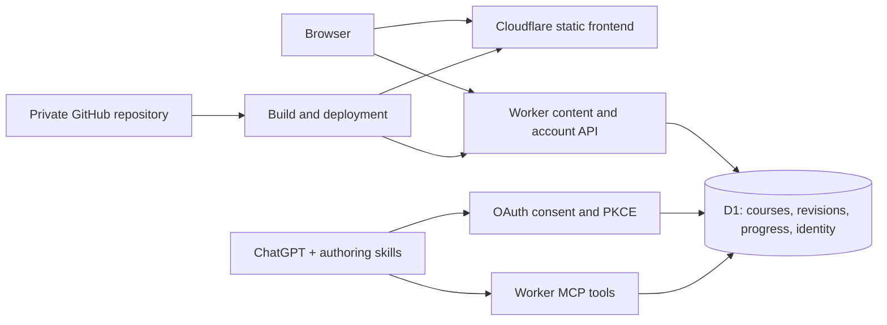

# Standalone Open Actuary

Decision checked 28 October 2026. Live app: https://open-actuary.subasj02.workers.dev. Private source: https://github.com/subasj0/open-actuary.

## System

- **Frontend:** React + Vite, static HTML/CSS/JS and self-hosted KaTeX fonts. Cloudflare Static Assets serves the frontend independently of API execution. Interactive experiments run in the browser. Existing visual design and Open Actuary v1 content format are retained. No Next.js/Vinext beta or Sites runtime remains.
- **Backend:** a small TypeScript Worker exposes the existing content API and a stateless MCP endpoint. No container, paid AI API, external database connection, or ChatGPT session is needed by learners.
- **Database:** Cloudflare D1 in APAC. Indexed documents, immutable revisions, separate live snapshots and review evidence, private learner progress, passkey public keys, expiring sessions and OAuth grants. User content and credentials stay on the server. Courses are portable JSON.
- **Identity:** WebAuthn passkeys via SimpleWebAuthn. Account names are display names, not verified email identities. Secure, HttpOnly, same-site cookies; hashed opaque session/recovery/OAuth tokens; one-use challenges; required user verification. Recovery rotates its one-use code, revokes sessions/tokens and removes old passkeys. Save the recovery code and add a second passkey. Email/password login and emailed resets are intentionally absent, avoiding an email delivery service.
- **Author permissions:** an invitation grants the first owner account an explicit database role. The invitation is in a local ignored file, never GitHub or public assets. Untrusted ChatGPT identity headers confer no permissions. Reader accounts cannot access drafts or publish.
- **ChatGPT integration:** OAuth authorization code with PKCE S256 and DCR, explicit author consent, resource-bound access tokens, rotating refresh tokens, revocation, and protected-resource discovery. Connect https://open-actuary.subasj02.workers.dev/mcp. Authoring remains in ChatGPT; the app does not pay to generate content. Publication still requires review evidence on the exact revision.
- **Operations:** daily cleanup of expired temporary identity records; sampled Cloudflare logs; versioned SQL migrations; D1 point-in-time recovery; private GitHub source and CI. Local CLI authentication is separate from the working Cloudflare plugin used for the first deployment.

## Cost and availability

Cloudflare Free is the selected target; no paid plan, domain purchase, AI subscription, or paid database was enabled by this migration. Your existing ChatGPT subscription remains separate from hosting costs.

| Component | Free allowance | Practical implication |
| --- | --- | --- |
| Static assets | Free, unlimited requests | Lesson UI, scripts, fonts and experiments do not spend dynamic request quota when served directly. |
| Worker API | 100,000 requests/day across the account; 10 ms CPU/invocation | Sufficient for a small library; other Workers on the account share the quota. Long jobs must be split or moved. |
| D1 | 5 million rows read/day, 100,000 rows written/day; 5 GB/account | Query rows, not SQL calls, count. Indexes matter. |
| D1 database | 500 MB/database on Free | This app initially occupies well under 1 MB, excluding future growth. Revision history and notes accumulate. |
| D1 recovery | 7 days of Time Travel | Export content before major changes; take external backups for longer retention. |
| Address | workers.dev subdomain with HTTPS | A custom domain is optional and has its own registration cost. |

**Feasible, not guaranteed:** normal small-library use should fit $0 hosting and require no manually awakened service. Free quotas are hard limits: hitting them can make API/database operations fail until reset. There is no paid uptime SLA or guaranteed latency. Traffic abuse, large database scans, unusually heavy imports, and long revision histories can exhaust limits even with few legitimate learners. Native passkey and OAuth flows were tested on the deployed Free-target stack; continued production observation is still needed.

Example capacity estimate, not a load-test promise: 200 daily learners × 10 lessons × approximately 5 dynamic requests/lesson = 10,000 API calls/day before search, account operations and other Workers. Reading and experimenting usually dominate; animations and slider changes run locally. The initial app bundle is approximately 168 KB compressed; math fonts load as needed. Network latency depends on the user's route and APAC database placement.

Upgrade when usage reaches roughly 70% of any quota, CPU-limit failures appear, or retention/support requirements exceed Free. Workers Paid starts at $5/month (usage overages can apply); no upgrade is automatic here. Do not claim that a free service has production guarantees.

## Alternatives considered

- **Supabase Free:** good managed Postgres and Auth, but projects pause after one week of inactivity. It also adds a second network/service dependency. Not used in this deployment; your existing Supabase project is unchanged.
- **Google Cloud Run:** useful for future heavy computation or long running jobs, but its free usage allowance is not a hard $0 bill. Compute beyond allowances and network transfer may incur charges; keeping minimum instances warm changes the cost model. Not needed for this browser-heavy app.
- **Existing ChatGPT Site:** retains tight ChatGPT identity/hosting coupling. Original Site remains intact during migration; its live content was copied rather than changing its audience or deleting it.

## Sources

- https://developers.cloudflare.com/workers/platform/pricing/
- https://developers.cloudflare.com/workers/platform/limits/
- https://developers.cloudflare.com/workers/static-assets/direct-upload/
- https://developers.cloudflare.com/d1/platform/pricing/
- https://developers.cloudflare.com/d1/platform/limits/
- https://supabase.com/pricing
- https://cloud.google.com/run/pricing
- https://simplewebauthn.dev/docs/packages/server
- https://modelcontextprotocol.io/specification/2025-11-25/basic/authorization
- https://developers.openai.com/plugins/build/auth
